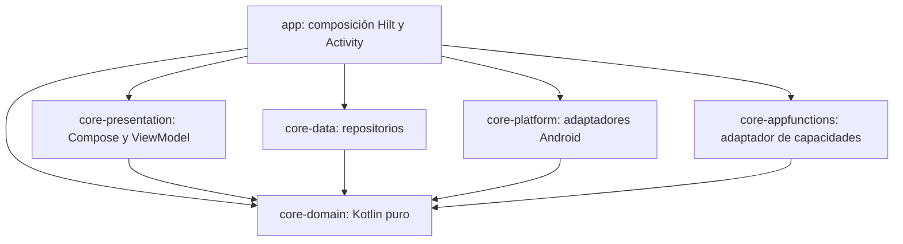
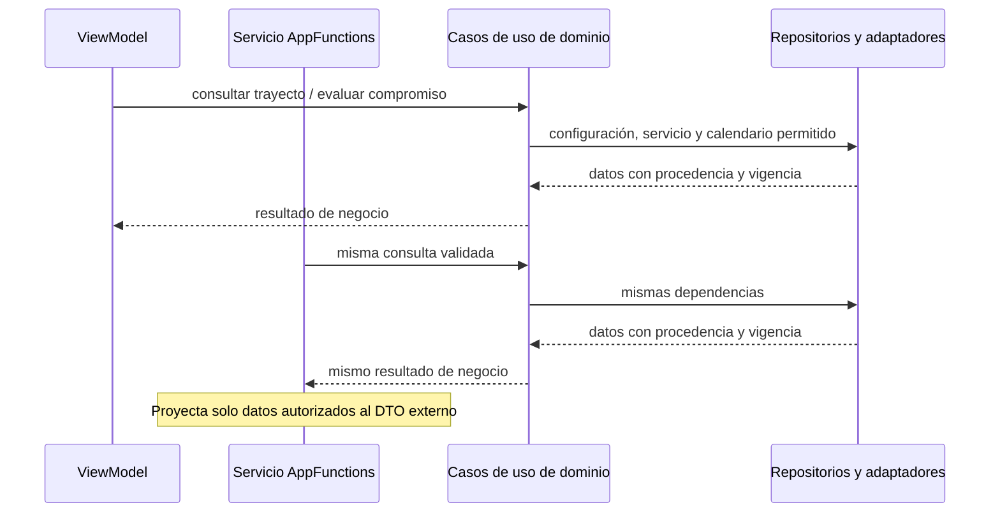

# Arquitectura · base e incrementos

Estado al 2026-11-02: base y UC-001–003 implementados; SDD activo. La etiqueta phase-0-base conserva el estado inicial.

## Dependencias de compilación

Los módulos Android son bibliotecas salvo `app`, que produce el APK. `core-domain`
y `core-data` son bibliotecas Kotlin/JVM. Este último podrá seguir siendo JVM
mientras red, parseo y repositorios no requieran Android. Persistencia DataStore
o CalendarContract vive en `core-platform`, detrás de un contrato de dominio.
No hay un módulo por pantalla, framework genérico, navegación ni backend.

`core-platform` y `core-appfunctions` son fronteras solicitadas explícitamente:
plataforma ya implementa DataStore; capacidades siguen sin servicio publicado. No se añaden
módulos `utils`, `common`, `network`, `feature-*` o de convenciones Gradle.

## Recorrido que ya funciona

`MainActivity` obtiene `HomeViewModel` mediante Hilt. `HomeRoute` observa su
`StateFlow` con `collectAsStateWithLifecycle`; `HomeScreen` solo recibe estado
y un callback. El ViewModel invoca `GetHabitualJourney` en `viewModelScope`.
Los casos `GetHabitualJourney` y `SaveHabitualJourney` consumen `JourneyRepository`;
`app/di/JourneyModule` lo enlaza a `DataStoreJourneyRepository` en plataforma y
crea DataStore como singleton. La implementación JVM en memoria queda para fixtures.

UC-001 permite guardar y editar origen, destino y duración de referencia.
El dominio valida y devuelve resultados tipados; la UI distingue lectura en curso,
ausencia y error. Plataforma persiste los tres campos en una única transacción.
Ubicar este repositorio en plataforma mantiene el acceso Android junto a DataStore
y evita una capa delegadora adicional; el repositorio ferroviario seguirá en data.
Esto no es una consulta Renfe ni un fixture de puntualidad.

## Qué es core-appfunctions

Es un adaptador Android de entrada a capacidades de negocio, al mismo nivel que
presentación. No es un agente ni un motor de orquestación. No tiene ViewModels,
Compose, navegación, acceso directo a Renfe, ContentResolver ni almacenamiento
de conversaciones. Depende de dominio y de la biblioteca Jetpack AppFunctions.
La composición Hilt del APK proporciona los mismos casos de uso a ambas entradas.

Al implementar las consultas, el módulo contendrá:

- Un servicio abstracto `BaseCopilotAppFunctionService : AppFunctionService`, con
  `@AppFunctionServiceEntryPoint` y `@AndroidEntryPoint`. KSP generará el servicio
  concreto y el esquema XML; se registrará el generado, no la clase abstracta.
- Métodos `suspend` con `@AppFunctionDeclaration(isDescribedByKDoc = true)` que
  validen entradas, invoquen el caso de uso y proyecten su resultado.
- DTO de frontera con `@AppFunctionSerializable(isDescribedByKDoc = true)` y
  KDoc inline para cada propiedad. Los modelos de dominio no llevan anotaciones.
- Traducción de errores de negocio a excepciones AppFunctions específicas y
  mensajes acotados; propagación de `CancellationException` y ninguna fuga de
  detalles internos. El adaptador moverá la ejecución al dispatcher adecuado;
  los repositorios harán sus operaciones bloqueantes seguras para el hilo principal.
- Metadatos `app_metadata.xml` con `appfn:instructions`, descripción de las
  capacidades, origen de los datos y relaciones entre consultas.

KSP de AppFunctions se activará en este módulo y se verificará la agregación
en `app` con `appfunctions:aggregateAppFunctions=true`, siguiendo ChatApp.
El APK tendrá un único entry point por compatibilidad con API 36. El servicio
exportado exigirá `android.permission.BIND_APP_FUNCTION_SERVICE`.
No se publican servicios ni metadatos vacíos o engañosos en la fase actual.

## Capacidad futura, sin duplicar negocio

El servicio debe funcionar con la Activity cerrada y tras recrearse el proceso.
Por eso la futura configuración persistida y la autorización de compartir
resultados no podrán vivir solo en el ViewModel. `viewModelScope` no se reutiliza
en el servicio: cada consumidor conserva su lifecycle y cancelación.

## Reutilización en otros proyectos

Reutilizamos el patrón de adaptador, versiones, configuración KSP, criterios de
KDoc, política de datos mínimos, mapeo de errores y pruebas de contrato. En la
POC esos elementos y la futura fachada ferroviaria conviven en este módulo.
Las funciones sobre trayectos y los contratos de Cercanías son específicos del
producto: este AAR aún no es un SDK empresarial independiente.

Al aparecer un segundo producto se podrá extraer la infraestructura comprobada
a un `core-appfunctions` común sin dependencia de Cercanías. Cada aplicación
conservará DTO, funciones y entry point propios. No diseñamos ahora un registro
genérico, una interfaz universal de herramientas ni una jerarquía de servicios.
Esto mantiene un coste pequeño y evita acoplar una librería corporativa a trenes.

## Decisiones que revisar

1. Seis módulos, dominio JVM y composición Hilt en `app`.
2. API mínima 26 para reducir compatibilidad; laboratorio AppFunctions en 36+.
3. SDK de compilación y target 37; AppFunctions beta01 fijada, exposición aplazada.
4. Casos de uso concretos con `suspend operator fun invoke`, sin clase base obligatoria.
5. Errores de negocio tipados cuando aparezcan; no anticipar un `Failure(Any?)` global.
6. Separar consentimiento Android para leer de autorización para compartir con agentes.
7. Persistencia, selección inequívoca de reunión, margen de llegada, zona horaria,
   alcance ferroviario y conservación de datos se concretarán en SDD.

## Incremento UC-002
`QueryJourneyArrival` vive en core-domain y recibe JourneyRepository,
JourneyFixtureRepository y Clock. El catálogo fijo reside en core-data;
Hilt lo enlaza en app. ArrivalViewModel/ArrivalPanel reciben resultados tipados.
No se amplían core-platform ni core-appfunctions, ni se añaden módulos. La futura
fachada AppFunctions consumirá este mismo caso, con mapeo explícito de java.time
a sus DTO y política de exposición por definir en UC-006.

## Incremento UC-003
QueryRailContext recibe referencia, asociación explícita de IDs, repositorio,
catálogo y Clock. Produce contexto cualitativo sin cambiar llegada. Contratos y
frescura/matching viven en domain; OkHttp, JSON y snapshot en data; estado y
selección en presentation. app aporta Hilt e INTERNET. Sin cambios en plataforma
ni AppFunctions. Los IDs solo prueban estaciones del snapshot: ninguna capa
afirma cobertura de línea, tren o servicio directo. Las consultas no persisten.
