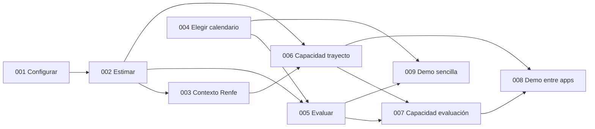

# Mapa de casos de uso y seguimiento

Fecha inicial: 2026-11-01. Este archivo es el tablero versionado del proyecto.
Base ejecutable: etiqueta `phase-0-base`. Adopción SDD: etiqueta `sdd-inception-v1`.

| Caso | Resultado de usuario | Dependencias | Estado | Plan / construcción |
| --- | --- | --- | --- | --- |
| UC-001 | [Configurar y conservar mi trayecto habitual](001-habitual-journey/spec.md) | Base phase-0-base. | Verified | 12/12; ver [evidencia](001-habitual-journey/verification.md) |
| UC-002 | [Consultar llegada de referencia y escenarios reproducibles](002-journey-estimate/spec.md) | UC-001. | Verified | 12/12; ver [evidencia](002-journey-estimate/verification.md) |
| UC-003 | [Consultar contexto ferroviario real con vigencia explícita](003-renfe-context/spec.md) | UC-002. | Verified | 14/14; ver [evidencia](003-renfe-context/verification.md) |
| UC-004 | [Elegir un compromiso del calendario del dispositivo](004-calendar-selection/spec.md) | Base Android; independiente de UC-001–003. | Verified | 14/14; ver [evidencia](004-calendar-selection/verification.md) |
| UC-005 | [Evaluar llegada frente al compromiso seleccionado](005-arrival-assessment/spec.md) | UC-002 y UC-004; UC-003 como contexto adicional. | Verified | 13/13; ver [evidencia](005-arrival-assessment/verification.md) |
| UC-006 | [Publicar la consulta de trayecto como capacidad](006-journey-capability/spec.md) | UC-002 y UC-003. | Verified | 15/15; ver [evidencia](006-journey-capability/verification.md) |
| UC-007 | [Compartir una evaluación mínima del compromiso autorizado](007-assessment-capability/spec.md) | UC-005 y UC-006. | Verified | 17/17; ver [evidencia](007-assessment-capability/verification.md) |
| UC-008 | [Orquestar propuesta a Ana con confirmación explícita](008-cross-app-demo/spec.md) | UC-006 y UC-007; ChatApp y Testing Agent oficiales. | Verified | 13/13; ver [evidencia](008-cross-app-demo/verification.md) |
| UC-009 | [Demo sencilla con calendario real](009-simple-demo/spec.md) | UC-004–008 | Verified | 7/7; ver [evidencia](009-simple-demo/verification.md) |

Cierre documental 2026-11-15: **UC-001–009 Verified**, **117/117 tareas**.
UC-009 es la demo principal; los snapshots previos se conservan como historia.
Ver [README](../README.md) y [evidencia de UC-009](009-simple-demo/verification.md).

## Orden y dependencias

La numeración propone el orden de aprendizaje; el diagrama expresa dependencias
reales. UC-004 puede prepararse de forma independiente. No desarrollamos nueve
capas por separado: cada caso acaba con comportamiento comprobable desde UI o,
en las últimas etapas, desde el consumidor externo además de la UI existente.

## Cómo interpretar el estado

- **Draft**: contrato propuesto; pendiente de revisión de alcance/supuestos.
- **Ready**: spec, plan y tareas revisados y petición de construcción recibida.
- **In progress**: se ejecutan sus tareas, como máximo un caso a la vez.
- **Verified**: aceptación satisfecha y evidencia registrada en `verification.md`.
- **Blocked**: obstáculo real encontrado, con causa y acción pendiente documentadas.

Estado al 2026-11-15: **UC-001–009 Verified**, **117/117 tareas completadas** y **9/9 casos Verified**. Las casillas
marcadas de `checklists/requirements.md` solo indican revisión del documento.
No representan tests ejecutados ni aprobación humana. Al implementar, actualizar
estado y tareas en el mismo commit que su código/evidencia.

## Recorrido de aprendizaje

- **UC-001**: Persistencia, lifecycle y ViewModel frente a Cubit.
- **UC-002**: java.time, Clock y coroutines testeables.
- **UC-003**: Repositorios, red, DTO y mapeo a dominio.
- **UC-004**: Permisos, ContentResolver, CalendarContract y recurrencias.
- **UC-005**: Casos de uso puros y pruebas de límites temporales.
- **UC-006**: AppFunctions, KSP, servicios, serialización e IPC.
- **UC-007**: Consentimiento de divulgación, frontera de datos y ciclo de vida sin interfaz.
- **UC-008**: Descubrimiento entre apps, privilegios y comprobación de efectos.
- **UC-009**: Demo de calendario real y tren sintético, con una consulta sin parámetros y consentimiento revocable.

## Contratos comunes a todas las specs

- «Mañana» = siguiente fecha local en la zona mostrada; nunca sumar ciegamente 24 horas.
- Hora de salida y compromiso se comparan como instantes, conservando contexto de zona.
- Duración de referencia, horario programado, predicción real y fixture son conceptos distintos.
- Una evaluación basada en referencia no garantiza la puntualidad real del tren.
- Lectura de calendario no implica permiso para divulgarlo a un agente.
- Envío requiere confirmación de destinatario y texto exactos; rechazo implica cero envíos.
- Los detalles nuevos de cada borrador se revisan al activarlo; no se consideran aprobados por generar este mapa.

## Cierre

UC-009 cierra el desarrollo solicitado. La demo sencilla es el punto de entrada;
UC-008 conserva el flujo determinista de mensajería local confirmada. No se inicia
otro incremento automáticamente. Ver [START_HERE](../START_HERE.md).

## Lectura de nombres históricos
Desde 2026-11-04 las bibliotecas pierden el prefijo core-: domain, data, platform,
presentation y appfunctions. Planes, tareas cerradas y evidencias conservan sus nombres
de ejecución; los quickstart se adaptan a los comandos actuales. Los snapshots Git
no se reescriben. Ver [decisión](../docs/module-organization.md).
